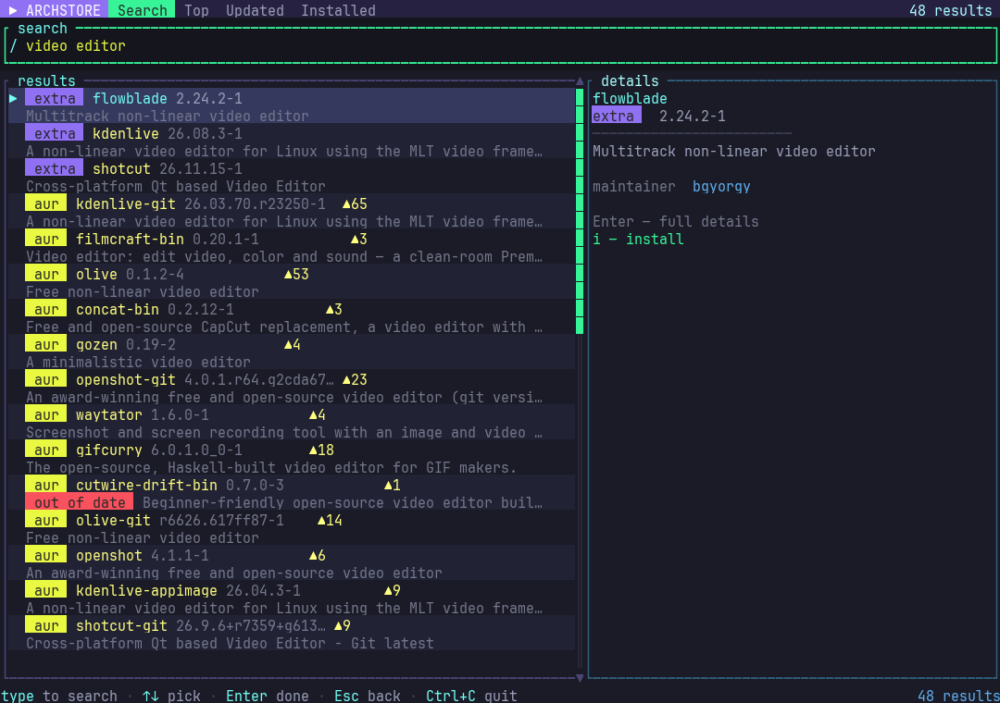
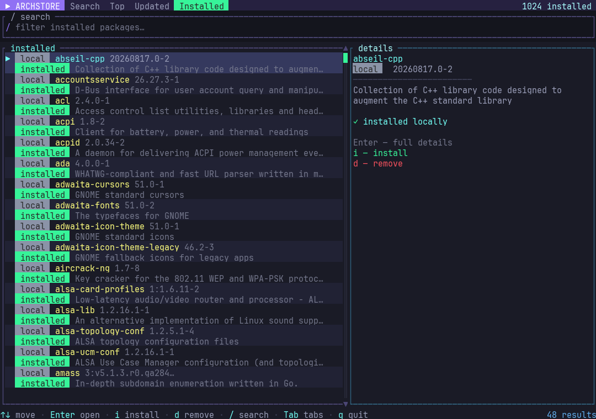
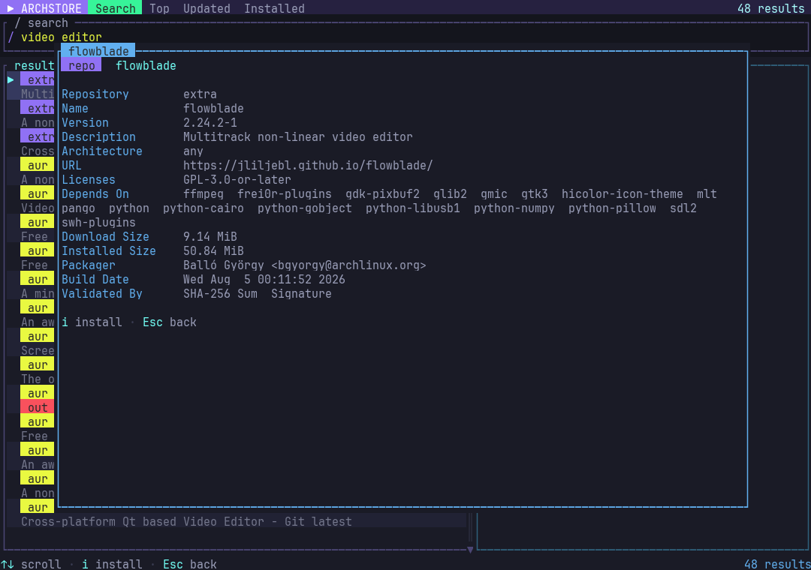
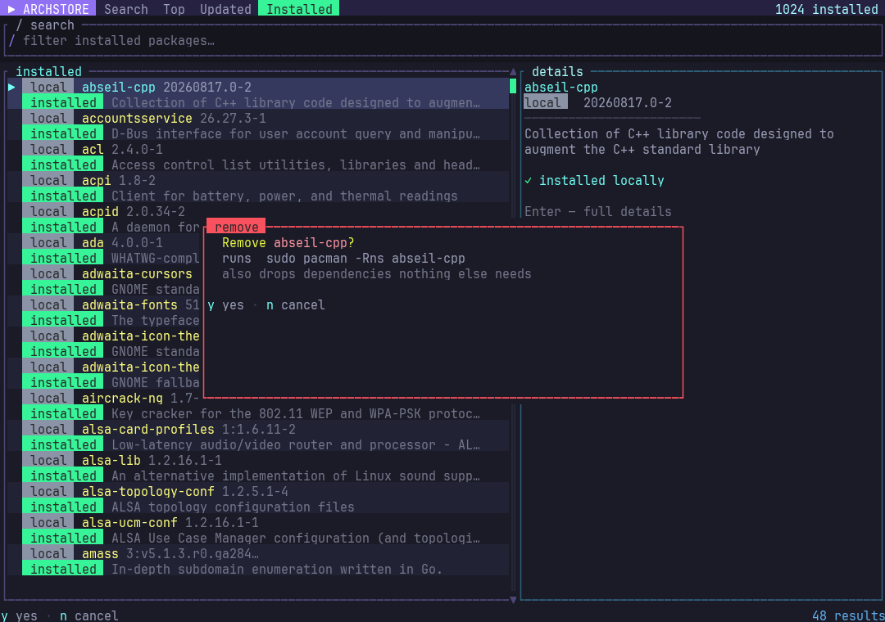

# archstore

**An Arch Linux package store in your terminal.** Search the official repositories
and the AUR side by side, browse what's popular, see what's out of date, manage
what's installed — all from one colorful, keyboard-only interface.

No vim modes. No commands to learn. Type, arrow keys, Enter.

```
archstore                 # open the store
archstore video editor    # open it, already searched
```



## Why

`pacman -Ss` gives you a wall of text. The AUR needs a separate helper and a
separate website. Checking what's installed, what's outdated, and what's
actually popular all live in different places.

archstore puts them in one screen with four tabs:

| Tab | What it shows |
| --- | --- |
| **Search** | live results from the official repos *and* the AUR as you type |
| **Top** | most popular AUR packages, ranked by votes |
| **Updated** | packages that changed recently |
| **Installed** | everything on your machine, filterable — install, inspect, remove |

Every package carries a colored badge telling you where it lives — `core`,
`extra`, `multilib`, `aur` — plus its version, an `installed` marker, an
`out of date` marker, and AUR vote counts.



## Install

### From source

```sh
git clone https://github.com/Mayzam-exe/archstore.git
cd archstore
cargo build --release
install -Dm755 target/release/archstore ~/.local/bin/archstore
```

Requires Rust (any recent stable) at build time, and `pacman` at runtime.

### Makepkg

```sh
makepkg -si
```

## Usage

```
archstore                 open the store
archstore <words>         open it, already searched for <words>
archstore --json <words>  print results as JSON (for scripts)
archstore --plain <words> print results as a plain list
archstore --offline ...   use only the local pacman database (no network)
```

### In the store

| Key | Action |
| --- | --- |
| *type* | search the repos + AUR as you type |
| `↑` `↓` `PgUp` `PgDn` | move through the results |
| `Enter` | open the package page |
| `i` | install (asks first) |
| `d` | remove an installed package (asks first) |
| `/` | focus the search bar |
| `Tab` / `1`-`4` | switch tab |
| `r` | refresh this tab |
| `F1` or `?` | help |
| `Esc` | leave the search bar / close overlays |
| `q` / `Ctrl+C` | quit — `Ctrl+C` works from anywhere |

The query you type **persists across tabs** — on the Installed tab it becomes a
filter, shown as `N of M match`.



## Install and remove

Installing hands the terminal over to `pacman` (or `yay`/`paru` for AUR
packages), so you get the normal password prompt and confirmation:

```
archstore → sudo pacman -S --needed kdenlive   (official repos)
```

Removing shows you the exact command first and warns you that it also drops
dependencies nothing else needs:



```
archstore → sudo pacman -Rns abseil-cpp   (sudo pacman -Rns)
```

Everything installed — repo or AUR — lives in pacman's local database, so one
command covers both.

## Design notes

- **Rust + ratatui**, so it starts instantly and redraws at terminal speed.
- **`reqwest` with `rustls`** — no OpenSSL dependency.
- **No daemon, no cache directory, no config file.** It reads `pacman`'s local
  database and hits `archlinux.org` / `aur.archlinux.org` directly.
- **Truecolor throughout** — the palette is declared once in `src/ui.rs`, and
  every surface (header band, search field, repo badges, row striping) is filled
  rather than left to the terminal default.
- **Offline-aware**: `--offline` uses only `pacman -Ss`, and a network failure
  falls back to it automatically instead of showing you nothing.

## Project layout

```
src/main.rs   app state, key handling, the event loop, install/remove
src/data.rs   package sources, relevance ranking, install routing, text helpers
src/ui.rs     rendering: header, search field, list, details, overlays
```

## License

[MIT](LICENSE)

## Contributing

Issues and PRs welcome. Arch-specific quirks (mirrors, AUR helpers, unusual
repo configurations) are especially worth reporting — test against a real
`pacman` setup, not a mock.

